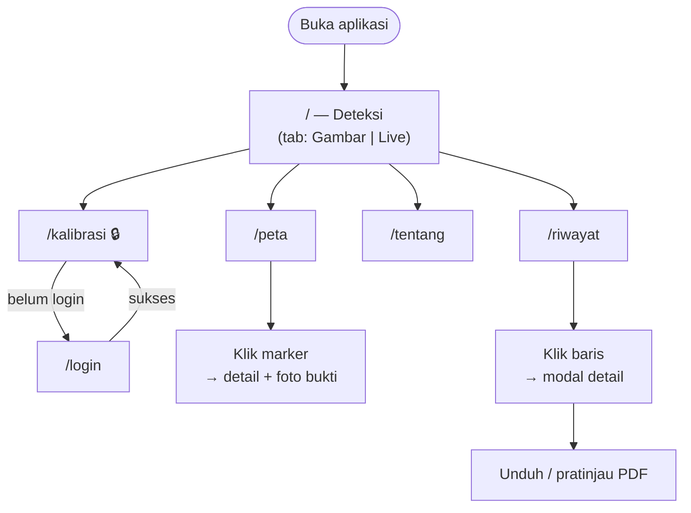
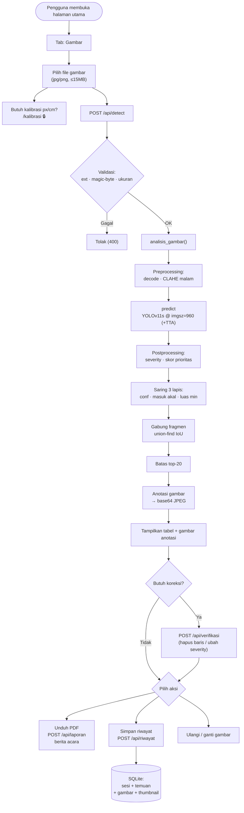
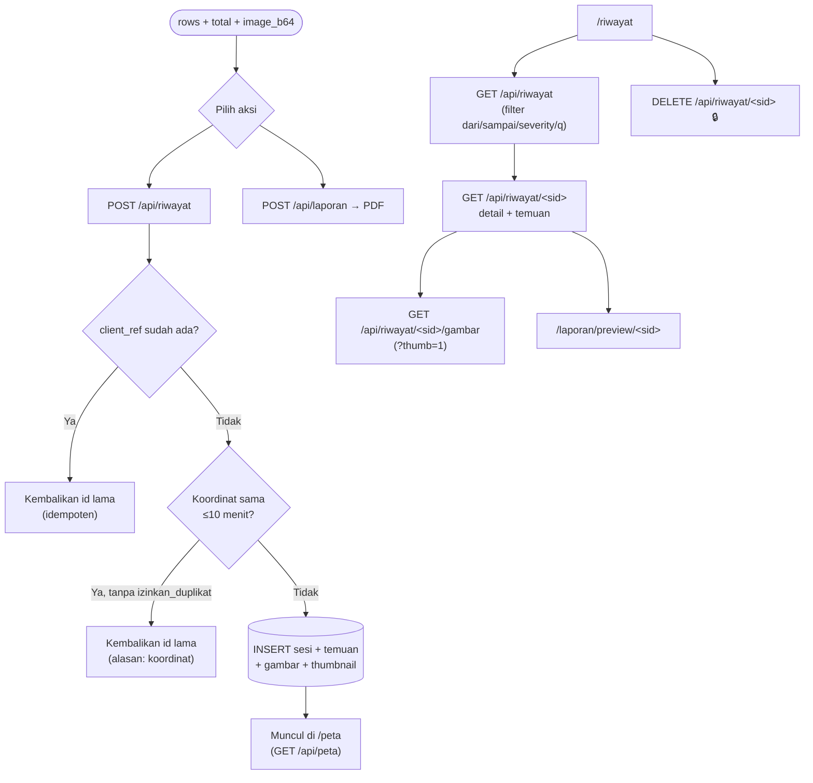
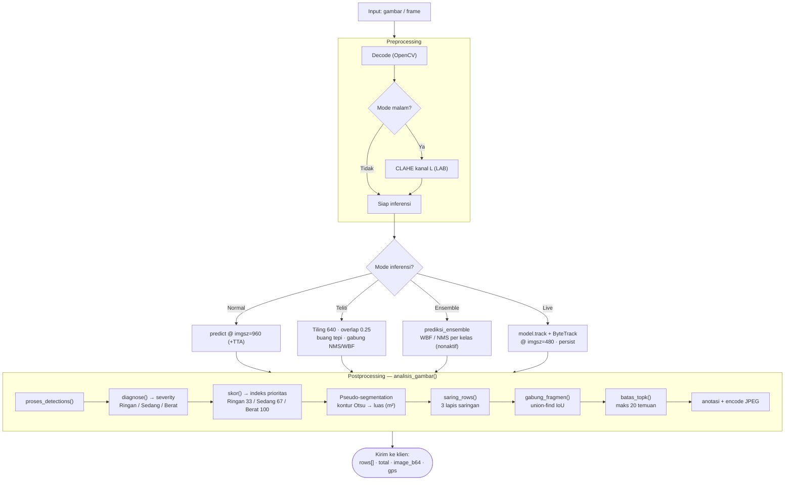
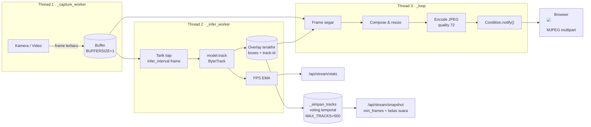

# User Flow — JalanPantau

Dokumen ini memetakan alur pengguna (user flow) aplikasi **JalanPantau**: aplikasi
deteksi kerusakan jalan berbasis Flask + YOLOv11.

Dokumen ini bersifat **deskriptif**, bukan kontrak engineering. Batasan
implementasi yang mengikat ada di [`../DESIGN.md`](../DESIGN.md); daftar route
lengkap ada di [`API.md`](API.md).

> **Scope (Okt 2026):** aplikasi ini **satu peran saja (admin)** dan berjalan
> lokal (bind `127.0.0.1`). Fitur lama — dashboard PUPR, disposisi/instansi,
> peran kontraktor, dan mode mobile — sudah **dihapus** dari kode; lihat riwayat
> git. Alur di bawah mengikuti route yang benar-benar terdaftar di `web/app.py`.

---

## 1. Daftar Isi

- [2. Ringkasan Arsitektur](#2-ringkasan-arsitektur)
- [3. Persona & Peran](#3-persona--peran)
- [4. Peta Navigasi](#4-peta-navigasi)
- [5. Alur Utama — Deteksi Gambar](#5-alur-utama--deteksi-gambar)
- [6. Alur Utama — Live Stream Real-Time](#6-alur-utama--live-stream-real-time)
- [7. Alur Riwayat, Peta & Laporan](#7-alur-riwayat-peta--laporan)
- [8. Diagram Pipeline Inferensi](#8-diagram-pipeline-inferensi)
- [9. Arsitektur 3-Thread Live Streaming](#9-arsitektur-3-thread-live-streaming)
- [10. Peta Kode Sumber](#10-peta-kode-sumber)

---

## 2. Ringkasan Arsitektur

Aplikasi ini adalah **Flask monolith** tanpa build step, server-side rendering
menggunakan Jinja2, dan vanilla JavaScript di sisi klien.

```
┌────────────────────────────┐
│         Browser            │
│  (Jinja2 + Leaflet + JS)   │
└───────────┬────────────────┘
            │ HTTP / JSON / MJPEG
┌───────────▼────────────────┐
│      Flask App             │
│      web/app.py            │
│  ┌───────────────────────┐ │
│  │ Auth · CSRF · Rate    │ │
│  │ Limit · Security Hdrs │ │
│  └───────────────────────┘ │
└───┬───────────┬───────────┘
    │           │
    │           ├──► web/deteksi.py     (Pipeline inferensi gambar)
    │           ├──► web/streaming.py   (Live 3-thread + ByteTrack)
    │           └──► app/laporan.py     (PDF via fpdf2)
    │
┌───▼────────────────────────┐
│   web/database.py          │
│   SQLite (riwayat.db)      │
└────────────────────────────┘
```

**Model Machine Learning** (satu model: YOLOv11s untuk gambar **dan** live):

| Peran | Model | Format | Config |
|-------|-------|--------|--------|
| Deteksi gambar (statis) | YOLOv11s | `.pt` (PyTorch) | `model_gambar` |
| Live stream (webcam/IP-cam/video) | YOLOv11s | `.onnx` (ONNX Runtime) | `model_live` |
| Cadangan (ensemble, nonaktif) | — | `.pt` | `ensemble` |

Kelas yang dideteksi: `longitudinal_crack`, `transverse_crack`,
`alligator_crack`, `other_corruption`, `pothole`.

Dataset latih: **RDD2022** (anotasi *bounding box*, bukan mask).

---

## 3. Persona & Peran

Hanya ada **satu peran terautentikasi (admin)**. Operator lapangan memakai
halaman publik tanpa login (aplikasi sengaja berjalan lokal untuk satu operator).

| Persona | Login | Halaman | Kemampuan |
|---------|-------|---------|-----------|
| **Operator** (publik) | tidak | `/`, `/peta`, `/riwayat`, `/tentang` | Deteksi gambar/live, koreksi hasil, simpan riwayat, unduh PDF, lihat peta |
| **Admin** | ya (session) | `+ /kalibrasi` | Semua di atas **plus** ubah kalibrasi `px/cm` dan hapus riwayat |

### Aturan Otorisasi (ditegakkan di server)

- Hanya **`POST /api/kalibrasi`**, **`POST /api/kalibrasi/foto`**, dan
  **`DELETE /api/riwayat/<sid>`** yang butuh login (API → `401` JSON; halaman
  `/kalibrasi` → redirect `/login`).
- Sisanya publik, namun dibatasi **rate-limit** (lihat [`API.md`](API.md)).
- Kepemilikan stream live dijaga satu **token**: saat stream berjalan,
  `start`/`stop`/`anotasi`/`snapshot` dari tab lain ditolak (`409`/`403`) bila
  tak menyertakan token pemilik.

---

## 4. Peta Navigasi



---

## 5. Alur Utama — Deteksi Gambar



### Kunci Teknis Alur Ini

1. **Validasi berlapis** — ekstensi **dan** magic byte (`\xff\xd8\xff` /
   `\x89PNG`) diperiksa, bukan hanya header. Batas ukuran 15 MB.
2. **Mode malam** — CLAHE diterapkan di kanal L (LAB), hanya fotometrik;
   geometri tidak berubah.
3. **Mode teliti** — *tiling* grid 640 dengan overlap 0,25; box yang menyentuh
   tepi dalam tile dibuang; digabung lintas tile via NMS/WBF.
4. **Pseudo-segmentation** — luas diestimasi dari kontur (Otsu/adaptive +
   morphology) di dalam bounding box. **Bukan** mask segmentasi model.
5. **Angka otoritatif** — skor tidak dipercaya dari klien: server menghitung
   ulang **total sesi** (= jumlah skor temuan) dan **skor tiap temuan** dari
   `severity` (Ringan 33 / Sedang 67 / Berat 100, rumus `app/prioritas.py`).

---

## 6. Alur Utama — Live Stream Real-Time


### Catatan Kinerja

- Inferensi live ONNX @480 ≈ **326 ms/frame** (~3 FPS infer).
- FPS **tampil** preview tetap **15+** karena arsitektur *decouple* 3-thread.
- Preset performa: `halus` (320/3/30) · `seimbang` (480/2/25) · `akurat` (640/1/15).

---

## 7. Alur Riwayat, Peta & Laporan

Setelah hasil deteksi (gambar atau snapshot live) ditinjau dan — bila perlu —
dikoreksi operator:



### Aturan Penting

- **Idempoten**: `client_ref` yang sama tidak membuat baris baru (aman dari klik
  dobel / retry jaringan).
- **Anti-duplikat titik**: koordinat sama dalam 10 menit terakhir ditolak kecuali
  `izinkan_duplikat: true`.
- **Skor server-side**: `total` = jumlah skor temuan, dan skor tiap temuan
  diturunkan dari `severity` — nilai dari klien diabaikan.
- **PDF** (`POST /api/laporan`) dibangun ulang tiap permintaan; berkas sementara
  dihapus setelah dikirim (dibaca ke memori lebih dulu agar tidak terkunci di
  Windows).

---

## 8. Diagram Pipeline Inferensi



### Jalur Saringan (3 Lapis)

| Lapis | Kriteria | Sumber |
|-------|----------|--------|
| 1 | `conf < ambang_efektif` per kelas | `toleransi_kelas` di `config/inferensi.yaml` |
| 2 | Ukuran fisik tidak masuk akal | `batas_ukuran` (300cm / 100cm / 100m²) |
| 3 | Luas piksel < `luas_min_px` (default 900) | `saring.luas_min_px` |

---

## 9. Arsitektur 3-Thread Live Streaming

Kunci kenapa preview tetap halus meski inferensi lambat: **decoupling** tiga
pekerjaan ke thread terpisah.



**Prinsip:** thread capture tidak pernah menunggu inferensi. Inferensi boleh
lag, tapi preview tidak boleh *stall*.

---

## 10. Peta Kode Sumber

Baris dapat bergeser seiring perubahan; nama fungsi/route adalah acuan utama.

### Route (`web/app.py`)

| Route | Baris | Catatan |
|-------|-------|---------|
| `GET/POST /login`, `GET /logout` | 244 / 250 / 272 | Autentikasi admin |
| `GET /` | 336 | Deteksi (tab Gambar & Live) |
| `GET /peta` | 340 | Peta sebaran GPS |
| `GET /riwayat` | 344 | Riwayat inspeksi |
| `GET /tentang` | 348 | Tentang & metrik model |
| `GET /kalibrasi` | 352 | 🔒 Kalibrasi `px/cm` |
| `GET /laporan/preview/<sid>` | 357 | Pratinjau berita acara |
| `POST /api/detect` | 365 | Deteksi gambar |
| `GET /api/kalibrasi` | 402 | Status kalibrasi |
| `POST /api/kalibrasi` | 413 | 🔒 Simpan kalibrasi |
| `POST /api/kalibrasi/foto` | 439 | 🔒 Foto penggaris → gambar+ukuran |
| `POST /api/verifikasi` | 478 | Koreksi operator |
| `POST /api/laporan` | 497 | Generate PDF |
| `GET /api/stream` | 529 | MJPEG |
| `POST /api/stream/start` | 598 | Mulai live stream |
| `POST /api/stream/stop` | 640 | Hentikan (token pemilik) |
| `GET /api/stream/stats` | 652 | FPS · track · deteksi |
| `POST /api/stream/anotasi` | 657 | Toggle anotasi box |
| `POST /api/stream/snapshot` | 666 | Snapshot per track |
| `POST /api/demo` | 678 | Video contoh bawaan |
| `POST /api/video` | 706 | Upload berkas video |
| `POST /api/riwayat` | 763 | Simpan sesi |
| `GET /api/riwayat` | 811 | Daftar riwayat |
| `GET /api/riwayat/<sid>` | 827 | Detail sesi |
| `DELETE /api/riwayat/<sid>` | 834 | 🔒 Hapus sesi |
| `GET /api/riwayat/<sid>/gambar` | 842 | JPEG bukti |
| `GET /api/peta` | 855 | Titik peta (publik) |

### Fungsi Inti

| Fungsi | File | Baris |
|--------|------|-------|
| `analisis_gambar` | `web/deteksi.py` | 1014 |
| `prediksi_teliti` | `web/deteksi.py` | 920 |
| `proses_detections` | `web/deteksi.py` | 625 |
| `gabung_fragmen` | `web/deteksi.py` | 647 |
| `saring_rows` | `web/deteksi.py` | 384 |
| `terapkan_koreksi` | `web/deteksi.py` | 419 |
| `get_model` (singleton) | `web/deteksi.py` | 567 |
| `kanonik_kelas` / `nama_kelas` | `web/deteksi.py` | 539 / 558 |
| `diagnose` (severity) | `app/severity.py` | 53 |
| `skor` (indeks prioritas) | `app/prioritas.py` | 31 |
| `total_prioritas` | `app/prioritas.py` | 56 |
| `buat_laporan` (PDF) | `app/laporan.py` | 35 |
| `simpan_sesi` | `web/database.py` | 248 |
| `daftar_sesi` | `web/database.py` | 344 |
| `detail_sesi` | `web/database.py` | 360 |
| `titik_peta` | `web/database.py` | 388 |
| `StreamManager` | `web/streaming.py` | 42 |

---

## Lampiran — Catatan Limitation yang Jujur

Aplikasi ini **sengaja** menyatakan batasan berikut (dari README & DESIGN):

1. **Bukan segmentasi.** Deteksi *bounding box*; luas diestimasi dari kontur
   di dalam box (*pseudo-segmentation*), bukan mask model.
2. **Akurasi belum mencapai target.** YOLOv11s: mAP50 val 0,616, test 0,617
   (target ≥ 0,65 belum tercapai). Dataset latih RDD2022 (India/Jepang).
3. **Kamera mono tidak mengukur kedalaman.** Tebal = asumsi per severity.
4. **Skor prioritas = indeks relatif** (Ringan 33 / Sedang 67 / Berat 100),
   bukan RAB/biaya resmi. Tidak ada komponen harga.
5. **Mode malam hanya fotometrik** (CLAHE), tidak menambah sumber cahaya.
6. **Istilah**: selalu "indeks/skor prioritas", **tidak pernah** "biaya
   perbaikan" mutlak.

---

*Dokumen ini dibuat untuk keperluan dokumentasi skripsi. Struktur route dan
nama fungsi diverifikasi langsung dari kode sumber (baris per Okt 2026).*
