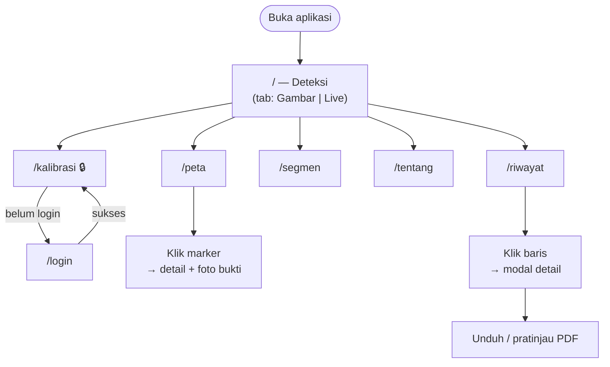
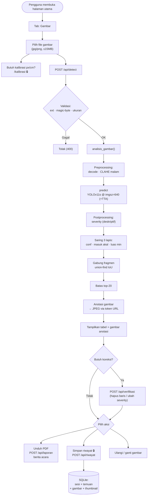
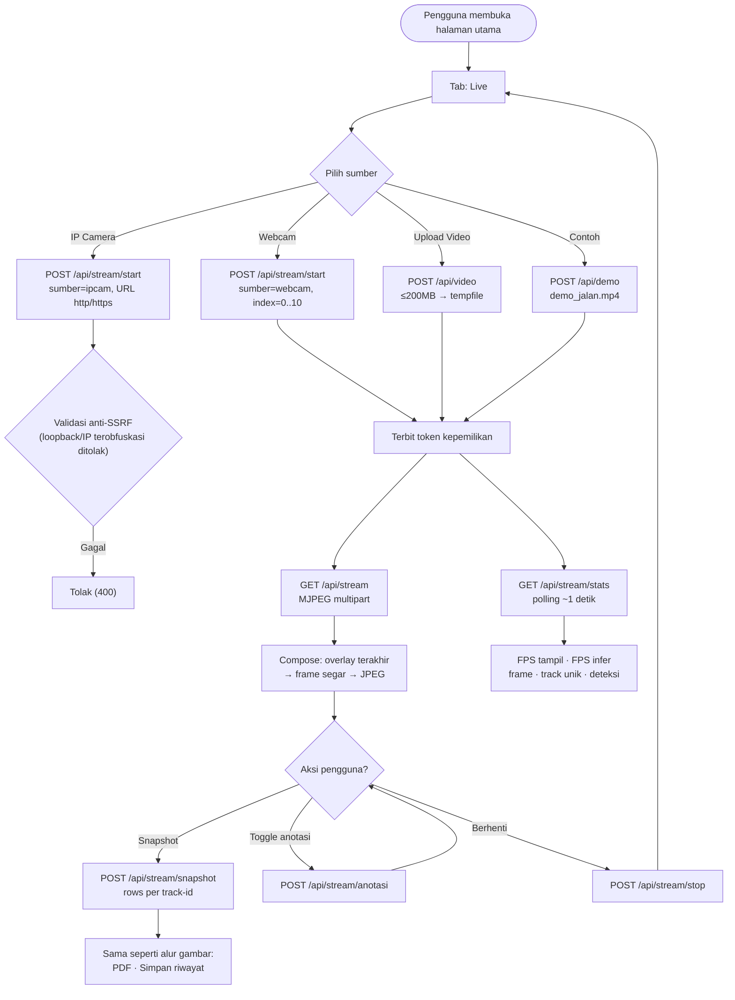
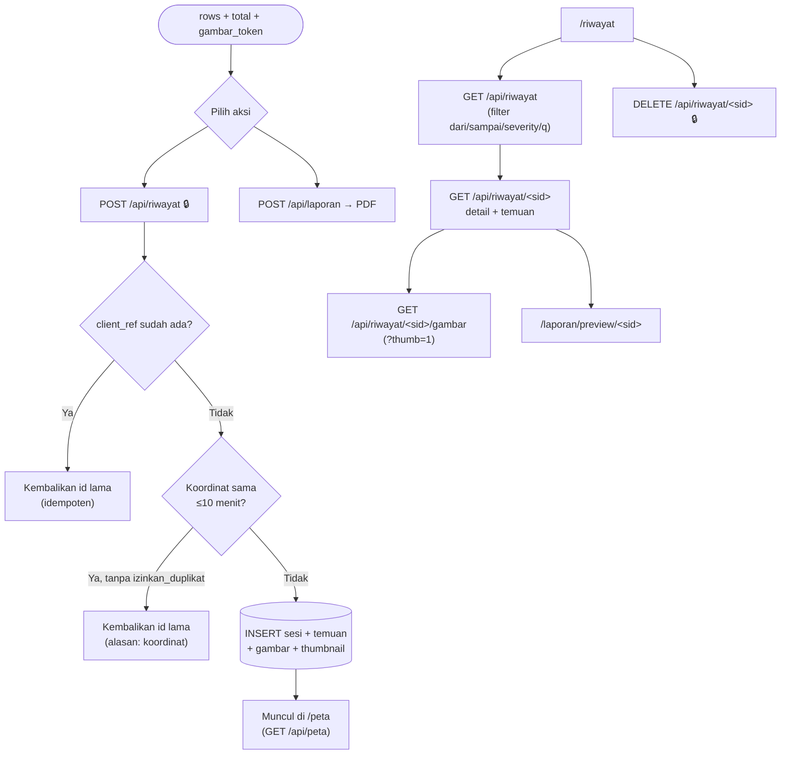
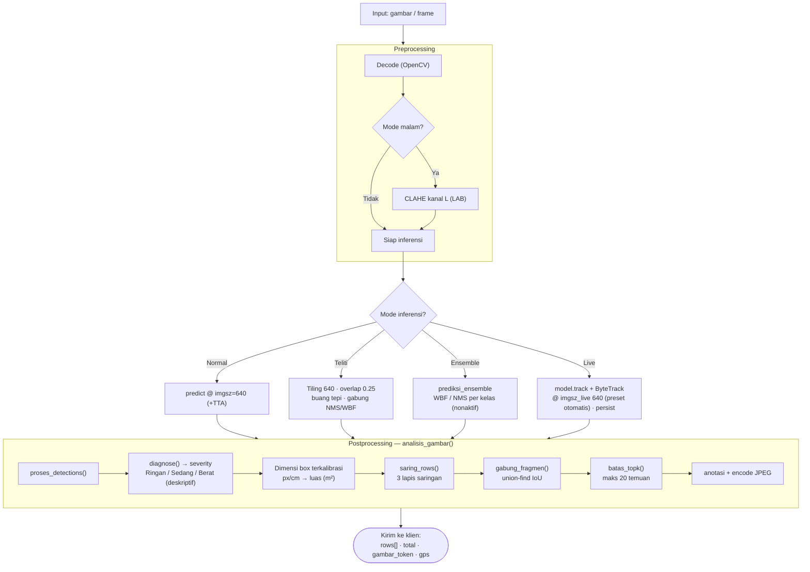
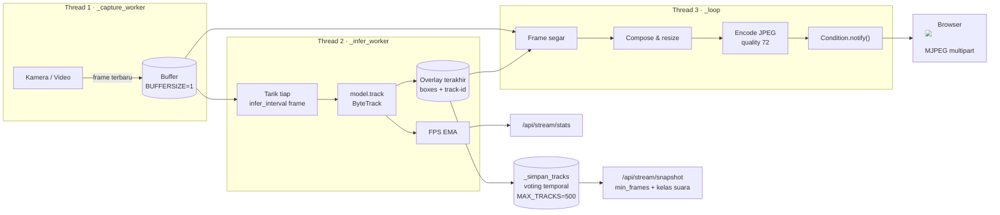

# User Flow — JalanPantau

Dokumen ini memetakan alur pengguna (user flow) aplikasi **JalanPantau**: aplikasi
deteksi kerusakan jalan berbasis Flask + YOLOv11.

Dokumen ini bersifat **deskriptif**, bukan kontrak engineering. Batasan
implementasi yang mengikat ada di [`../DESIGN.md`](../DESIGN.md); daftar route
lengkap ada di [`API.md`](API.md).

> **Scope (Okt 2026):** aplikasi ini **satu peran saja (admin)** dan berjalan
> lokal (bind `127.0.0.1`). Fitur lama — dashboard PUPR, disposisi/instansi,
> peran kontraktor, dan mode mobile — sudah **dihapus** dari kode; lihat riwayat
> git. Alur di bawah mengikuti route yang benar-benar terdaftar di `web/app.py`.

---

## 1. Daftar Isi

- [2. Ringkasan Arsitektur](#2-ringkasan-arsitektur)
- [3. Persona & Peran](#3-persona--peran)
- [4. Peta Navigasi](#4-peta-navigasi)
- [5. Alur Utama — Deteksi Gambar](#5-alur-utama--deteksi-gambar)
- [6. Alur Utama — Live Stream Real-Time](#6-alur-utama--live-stream-real-time)
- [7. Alur Riwayat, Peta & Laporan](#7-alur-riwayat-peta--laporan)
- [8. Diagram Pipeline Inferensi](#8-diagram-pipeline-inferensi)
- [9. Arsitektur 3-Thread Live Streaming](#9-arsitektur-3-thread-live-streaming)
- [10. Peta Kode Sumber](#10-peta-kode-sumber)

---

## 2. Ringkasan Arsitektur

Aplikasi ini adalah **Flask monolith** tanpa build step, server-side rendering
menggunakan Jinja2, dan vanilla JavaScript di sisi klien.

```
┌────────────────────────────┐
│         Browser            │
│  (Jinja2 + Leaflet + JS)   │
└───────────┬────────────────┘
            │ HTTP / JSON / MJPEG
┌───────────▼────────────────┐
│      Flask App             │
│      web/app.py            │
│  ┌───────────────────────┐ │
│  │ Auth · CSRF · Rate    │ │
│  │ Limit · Security Hdrs │ │
│  └───────────────────────┘ │
└───┬───────────┬───────────┘
    │           │
    │           ├──► web/deteksi.py     (Pipeline inferensi gambar)
    │           ├──► web/streaming.py   (Live 3-thread + ByteTrack)
    │           └──► app/laporan.py     (PDF via fpdf2)
    │
┌───▼────────────────────────┐
│   web/database.py          │
│   SQLite (riwayat.db)      │
└────────────────────────────┘
```

**Model Machine Learning** (YOLOv11s untuk gambar **dan** live; file bobot
boleh sama, tetapi tiap jalur memakai *instance* model terpisah agar state
`predictor`/`trackers` tidak saling menimpa):

| Peran | Model | Format | Config |
|-------|-------|--------|--------|
| Deteksi gambar (statis) | YOLOv11s | `.pt` (PyTorch) | `model_gambar` |
| Live stream (webcam/IP-cam/video) | YOLOv11s | `.pt` (PyTorch); `.onnx` cadangan CPU via `mode_backend: auto` | `model_live` |
| Cadangan (ensemble, nonaktif) | — | `.pt` | `ensemble` |

Kelas yang dideteksi: `longitudinal_crack`, `transverse_crack`,
`alligator_crack`, `other_corruption`, `pothole`.

Dataset latih: **RDD2022** (anotasi *bounding box*, bukan mask).

---

## 3. Persona & Peran

Hanya ada **satu peran terautentikasi (admin)**. Operator lapangan memakai
halaman publik tanpa login (aplikasi sengaja berjalan lokal untuk satu operator).

| Persona | Login | Halaman | Kemampuan |
|---------|-------|---------|-----------|
| **Operator** (publik) | tidak | `/`, `/peta`, `/riwayat`, `/segmen`, `/tentang` | Deteksi gambar/live, koreksi hasil, unduh PDF, lihat peta & segmen |
| **Admin** | ya (session) | `+ /kalibrasi` | Semua di atas **plus** simpan/hapus riwayat, ubah kalibrasi `px/cm`, dan kelola segmen (buat/ubah/hapus + tetapkan anggota) |

### Aturan Otorisasi (ditegakkan di server)

- Login bersifat *deferred*: aksi publik berjalan tanpa login, tetapi aksi
  tulis memicu modal login dan otomatis dilanjutkan setelah berhasil
  (sesi tetap 8 jam sejak login pertama; tidak ada halaman register).
- Endpoint yang butuh login (`@login_wajib` di `web/app.py`; API → `401`
  JSON; halaman `/kalibrasi` → redirect `/login`):
  `POST /api/kalibrasi`, `POST /api/kalibrasi/foto`, `POST /api/riwayat`,
  `DELETE /api/riwayat/<sid>`, `PUT /api/riwayat/<sid>/segmen`,
  `POST /api/segmen`, `PUT /api/segmen/<sid>`, `DELETE /api/segmen/<sid>`,
  `POST /api/segmen/<sid>/anggota`,
  `DELETE /api/segmen/<sid>/anggota/<sesi_id>`, dan halaman `GET /kalibrasi`.
- Sisanya publik, namun dibatasi **rate-limit** (lihat [`API.md`](API.md)).
- Kepemilikan stream live dijaga satu **token**: saat stream berjalan,
  `start`/`stop`/`anotasi`/`snapshot` dari tab lain ditolak (`409`/`403`) bila
  tak menyertakan token pemilik.

---

## 4. Peta Navigasi



---

## 5. Alur Utama — Deteksi Gambar



### Kunci Teknis Alur Ini

1. **Validasi berlapis** — ekstensi **dan** magic byte (`\xff\xd8\xff` /
   `\x89PNG`) diperiksa, bukan hanya header. Batas ukuran 15 MB.
2. **Mode malam** — CLAHE diterapkan di kanal L (LAB), hanya fotometrik;
   geometri tidak berubah.
3. **Mode teliti** — *tiling* grid 640 dengan overlap 0,25; box yang menyentuh
   tepi dalam tile dibuang; digabung lintas tile via NMS/WBF.
4. **Estimasi dimensi dari box** — luas diestimasi dari dimensi bounding box
   terkalibrasi (`pixels_per_cm`): lebar × panjang box. **Bukan** mask
   segmentasi model, dan bukan kontur — pseudo-segmentation pernah ada dan
   sudah dihapus dari kode; lihat lampiran.
5. **Angka otoritatif** — nilai dari klien tidak dipercaya: server
   menghitung ulang severity dan agregat sesi dari hasil deteksi. Skor
   severity per temuan (33/67/100, `app/prioritas.py`) hanya disimpan
   sebagai data *legacy* untuk kompatibilitas data lama — tidak ditampilkan
   dan bukan instrumen prioritas; prioritas resmi adalah **SDI-visual per
   segmen** (`app/sdi.py`).

---

## 6. Alur Utama — Live Stream Real-Time



### Catatan Kinerja

- Inferensi live ONNX @480 ≈ **326 ms/frame** (~3 FPS infer) **di dalam app**;
  benchmark model terisolasi @480 ≈ **93 ms** (~11 FPS). Selisih berasal dari
  capture/compose/JPEG yang berbagi CPU.
- FPS **tampil** preview tetap **15+** karena arsitektur *decouple* 3-thread.
- Preset performa: `halus` (320/1/30) · `seimbang` (640/1/30) · otomatis
  (CPU → halus, GPU → seimbang).

---

## 7. Alur Riwayat, Peta & Laporan

Setelah hasil deteksi (gambar atau snapshot live) ditinjau dan — bila perlu —
dikoreksi operator:



### Aturan Penting

- **Idempoten**: `client_ref` yang sama tidak membuat baris baru (aman dari klik
  dobel / retry jaringan).
- **Anti-duplikat titik**: koordinat sama dalam 10 menit terakhir ditolak kecuali
  `izinkan_duplikat: true`.
- **Hitungan server-side**: severity dan agregat sesi dihitung ulang server
  dari hasil deteksi — nilai dari klien diabaikan. (Kolom skor severity
  per temuan dipertahankan sebagai data *legacy*; lihat §5 poin 5.)
- **PDF** (`POST /api/laporan`) dibangun ulang tiap permintaan; berkas sementara
  dihapus setelah dikirim (dibaca ke memori lebih dulu agar tidak terkunci di
  Windows).

---

## 8. Diagram Pipeline Inferensi



### Jalur Saringan (3 Lapis)

| Lapis | Kriteria | Sumber |
|-------|----------|--------|
| 1 | `conf < ambang_efektif` per kelas | `toleransi_kelas` di `config/inferensi.yaml` |
| 2 | Ukuran fisik tidak masuk akal | `batas_ukuran` (300cm / 100cm / 100m²) |
| 3 | Luas piksel < `luas_min_px` (default 900) | `saring.luas_min_px` |

---

## 9. Arsitektur 3-Thread Live Streaming

Kunci kenapa preview tetap halus meski inferensi lambat: **decoupling** tiga
pekerjaan ke thread terpisah.



**Prinsip:** thread capture tidak pernah menunggu inferensi. Inferensi boleh
lag, tapi preview tidak boleh *stall*.

---

## 10. Peta Kode Sumber

Baris dapat bergeser seiring perubahan; nama fungsi/route adalah acuan utama.

### Route (`web/app.py`)

| Route | Baris | Catatan |
|-------|-------|---------|
| `GET/POST /login`, `GET /logout` | 322 / 328 / 351 | Autentikasi admin (halaman) |
| `POST /api/login` | 356 | Login JSON untuk modal (deferred-login) |
| `GET /` | 433 | Deteksi (tab Gambar & Live) |
| `GET /peta` | 437 | Peta sebaran GPS |
| `GET /riwayat` | 441 | Riwayat inspeksi |
| `GET /segmen` | 445 | Segmen jalan + SDI-visual |
| `GET /tentang` | 449 | Tentang & metrik model |
| `GET /health` | 453 | Status worker + perangkat |
| `GET /kalibrasi` | 463 | 🔒 Kalibrasi `px/cm` |
| `GET /laporan/preview/<sid>` | 468 | Pratinjau berita acara |
| `POST /api/detect` | 476 | Deteksi gambar |
| `GET /api/kalibrasi` | 534 | Status kalibrasi |
| `POST /api/kalibrasi` | 545 | 🔒 Simpan kalibrasi |
| `POST /api/kalibrasi/foto` | 571 | 🔒 Foto penggaris → gambar+ukuran |
| `POST /api/verifikasi` | 621 | Koreksi operator |
| `POST /api/laporan` | 640 | Generate PDF |
| `GET /api/stream` | 670 | MJPEG |
| `POST /api/stream/start` | 739 | Mulai live stream |
| `POST /api/stream/stop` | 783 | Hentikan (token pemilik) |
| `GET /api/stream/stats` | 795 | FPS · track · deteksi |
| `POST /api/stream/anotasi` | 807 | Toggle anotasi box |
| `POST /api/stream/snapshot` | 816 | Snapshot per track |
| `GET /api/gambar/<token>` | 831 | JPEG anotasi via token URL |
| `POST /api/demo` | 847 | Video contoh bawaan |
| `POST /api/video` | 877 | Upload berkas video |
| `POST /api/riwayat` | 934 | 🔒 Simpan sesi |
| `GET /api/riwayat` | 988 | Daftar riwayat |
| `GET /api/riwayat/<sid>` | 1004 | Detail sesi |
| `DELETE /api/riwayat/<sid>` | 1011 | 🔒 Hapus sesi |
| `PUT /api/riwayat/<sid>/segmen` | 1019 | 🔒 Tetapkan/lepas segmen sesi |
| `GET /api/riwayat/<sid>/gambar` | 1037 | JPEG bukti |
| `GET /api/peta` | 1056 | Titik peta (publik) |
| `POST /api/segmen` | 1061 | 🔒 Buat segmen |
| `GET /api/segmen` | 1076 | Daftar segmen |
| `GET /api/segmen/<sid>` | 1080 | Detail segmen + SDI-visual |
| `PUT /api/segmen/<sid>` | 1088 | 🔒 Ubah segmen |
| `DELETE /api/segmen/<sid>` | 1104 | 🔒 Hapus segmen |
| `POST /api/segmen/<sid>/anggota` | 1111 | 🔒 Tambah sesi ke segmen |
| `DELETE /api/segmen/<sid>/anggota/<sesi_id>` | 1127 | 🔒 Lepas sesi dari segmen |
| `GET /api/segmen/<sid>/pdf` | 1135 | PDF laporan SDI segmen |

### Fungsi Inti

| Fungsi | File |
|--------|------|
| `analisis_gambar` | `web/deteksi.py` |
| `prediksi_teliti` | `web/deteksi.py` |
| `proses_detections` | `web/deteksi.py` |
| `gabung_fragmen` | `web/deteksi.py` |
| `saring_rows` | `web/deteksi.py` |
| `terapkan_koreksi` | `web/deteksi.py` |
| `get_model` (cache per ruang+path) | `web/deteksi.py` |
| `kanonik_kelas` / `nama_kelas` | `web/deteksi.py` |
| `diagnose` (severity) | `app/severity.py` |
| `agregasi_segmen` / `hitung_sdi` (SDI-visual) | `app/sdi.py` |
| `putusan_gate` / `saring_gate_basah` (gate basah) | `app/scene_gate.py` |
| `skor` / `total_prioritas` (LEGACY, kompat data lama) | `app/prioritas.py` |
| `buat_laporan` / `buat_laporan_segmen` (PDF) | `app/laporan.py` |
| `simpan` (gambar anotasi → token) | `web/gambar_sementara.py` |
| `simpan_sesi` | `web/database.py` |
| `daftar_sesi` | `web/database.py` |
| `detail_sesi` | `web/database.py` |
| `titik_peta` | `web/database.py` |
| `StreamManager` | `web/streaming.py` |

---

## Lampiran — Catatan Limitation yang Jujur

Aplikasi ini **sengaja** menyatakan batasan berikut (dari README & DESIGN):

1. **Bukan segmentasi.** Deteksi *bounding box*; luas diestimasi dari
   dimensi box terkalibrasi, bukan mask model. (Pseudo-segmentation sudah
   dihapus dari kode.)
2. **Akurasi belum mencapai target.** YOLOv11s (retrain 18 Okt 2026): mAP50
   val 0,631, test 0,632 (target ≥ 0,65 belum tercapai). Dataset latih
   RDD2022 (India/Jepang).
3. **Kamera mono tidak mengukur kedalaman.** Tebal = asumsi per severity.
4. **Prioritas = SDI-visual per segmen**, bukan RAB/biaya resmi; tidak ada
   komponen harga. Skor severity per temuan (33/67/100) adalah data
   *legacy* internal — disimpan demi kompatibilitas data lama, tidak
   ditampilkan, dan tidak dipakai menentukan prioritas.
5. **Mode malam hanya fotometrik** (CLAHE), tidak menambah sumber cahaya.
6. **Istilah**: prioritas selalu dinyatakan sebagai "SDI-visual",
   **tidak pernah** "biaya perbaikan" mutlak.

---

*Dokumen ini dibuat untuk keperluan dokumentasi skripsi. Struktur route dan
nama fungsi diverifikasi langsung dari kode sumber (baris per 27 Okt 2026,
commit `5a31454`).*
