# User Flow — JalanPantau

Dokumen ini memetakan alur pengguna (user flow) aplikasi **JalanPantau**: aplikasi
deteksi kerusakan jalan *real-time* berbasis Flask + YOLOv11.

Dokumen ini bersifat **deskriptif**, bukan kontrak engineering. Batasan
implementasi yang mengikat ada di [`../DESIGN.md`](../DESIGN.md).

---

## 1. Daftar Isi

- [2. Ringkasan Arsitektur](#2-ringkasan-arsitektur)
- [3. Persona & Peran](#3-persona--peran)
- [4. Peta Navigasi](#4-peta-navigasi)
- [5. Alur Utama — Deteksi Gambar](#5-alur-utama--deteksi-gambar)
- [6. Alur Utama — Live Stream Real-Time](#6-alur-utama--live-stream-real-time)
- [7. Alur Verifikasi & Penerbitan SPK](#7-alur-verifikasi--penerbitan-spk)
- [8. Alur Kerja Kontraktor](#8-alur-kerja-kontraktor)
- [9. Alur Penerimaan Hasil Kerja (BAST)](#9-alur-penerimaan-hasil-kerja-bast)
- [10. Diagram State Machine Status](#10-diagram-state-machine-status)
- [11. Diagram Pipeline Inferensi](#11-diagram-pipeline-inferensi)
- [12. Arsitektur 3-Thread Live Streaming](#12-arsitektur-3-thread-live-streaming)
- [13. Peta Kode Sumber](#13-peta-kode-sumber)

---

## 2. Ringkasan Arsitektur

Aplikasi ini adalah **Flask monolith** tanpa build step, server-side rendering
menggunakan Jinja2, dan vanilla JavaScript di sisi klien.

```
┌────────────────────────────┐
│         Browser            │
│  (Jinja2 + Leaflet + JS)   │
└───────────┬────────────────┘
            │ HTTP / JSON / MJPEG
┌───────────▼────────────────┐
│      Flask App             │
│      web/app.py            │
│  ┌───────────────────────┐ │
│  │ Auth · CSRF · Rate    │ │
│  │ Limit · Security Hdrs │ │
│  └───────────────────────┘ │
└───┬───────────┬───────────┘
    │           │
    │           ├──► web/deteksi.py     (Pipeline inferensi gambar)
    │           ├──► web/streaming.py   (Live 3-thread + ByteTrack)
    │           └──► app/laporan.py     (PDF via fpdf2)
    │
┌───▼────────────────────────┐
│   web/database.py          │
│   SQLite (riwayat.db)      │
└────────────────────────────┘
```

**Model Machine Learning:**

| Peran | Model | Format | Config |
|-------|-------|--------|--------|
| Deteksi gambar (statis) | YOLOv11s | `.pt` (PyTorch) | `model_gambar` |
| Live stream (webcam/IP-cam/video) | YOLOv11n | `.onnx` (ONNX Runtime) | `model_live` |
| Cadangan (ensemble, nonaktif) | — | `.pt` | `ensemble` |

Kelas yang dideteksi: `longitudinal_crack`, `transverse_crack`,
`alligator_crack`, `other_corruption`, `pothole`.

Dataset latih: **RDD2022** (14.176 gambar, anotasi *bounding box* 5 kolom).

---

## 3. Persona & Peran

Aplikasi ini memiliki **tiga persona utama** dengan hak akses berbeda.

| Persona | Peran di DB | Halaman Utama | Kemampuan |
|---------|-------------|----------------|-----------|
| **Operator lapangan** | (tanpa login, publik) | `/` , `/peta` , `/riwayat` , `/disposisi` | Deteksi, simpan riwayat, kirim laporan, pantau peta |
| **Administrator dinas** | `admin` dengan `daerah` | `/pupr-<slug>/dashboard/*` | Verifikasi, terbitkan SPK, kelola kontraktor, terima hasil kerja |
| **Kontraktor** | `kontraktor_akun` | `/kontraktor/*` | Lihat SPK sendiri, kerjakan, unggah foto bukti |
| **Superadmin** | `admin` dengan `daerah = '-'` | Semua + `/dashboard/instansi` | Kelola instansi & akun daerah |

### Aturan Otorisasi ( ditegakkan di server )

- Admin berdaerah **terkunci** ke daerahnya sendiri (`_dashboard_ok`, `_wewenang_ok`).
- Kontraktor **hanya** melihat SPK miliknya (`spk_boleh_akses`). SPK milik
  orang lain dijawab **404** (bukan 403) agar keberadaan tidak terkonfirmasi.
- Peta kontraktor **tidak** memakai `/api/peta` publik; memakai
  `titik_peta_kontraktor`.
- Transisi status **hanya satu tahap** — tidak bisa melompat.

---

## 4. Peta Navigasi

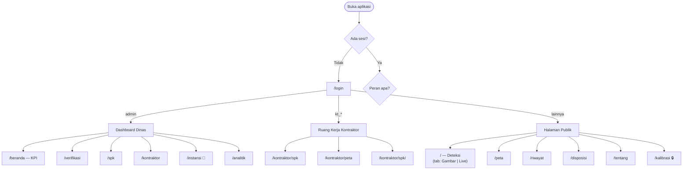

---

## 5. Alur Utama — Deteksi Gambar

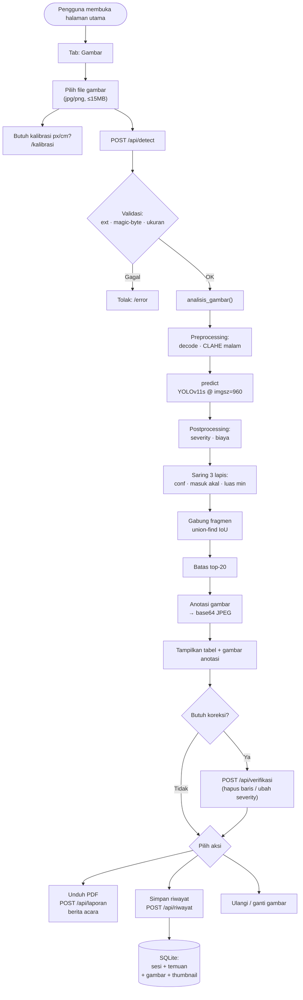

### Kunci Teknis Alur Ini

1. **Validasi berlapis** — ekstensi **dan** magic byte (`\xff\xd8\xff` /
   `\x89PNG`) diperiksa, bukan hanya header.
2. **Mode malam** — CLAHE diterapkan di kanal L (LAB), hanya fotometrik;
   geometri tidak berubah.
3. **Mode teliti** — *tiling* grid 640 dengan overlap 0,25; box yang menyentuh
   tepi dalam tile dibuang; digabung lintas tile via NMS/WBF.
4. **Pseudo-segmentation** — luas diestimasi dari kontur (Otsu/adaptive +
   morphology) di dalam bounding box. **Bukan** mask segmentasi model.
5. **Angka otoritatif** — saat kirim disposisi, angka total **diambil ulang
   dari DB** (`rekap_temuan`), bukan dipercaya dari klien.

---

## 6. Alur Utama — Live Stream Real-Time

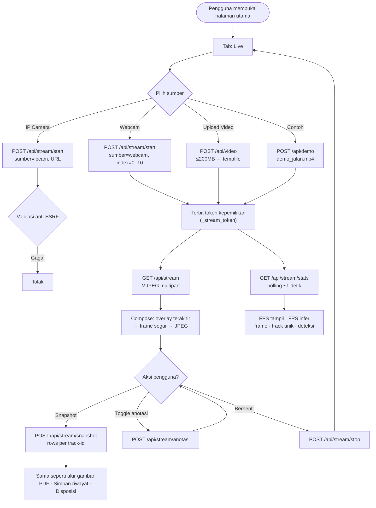

### Catatan Kinerja

- Inferensi YOLOv11n ONNX @480 ≈ **326 ms/frame** (~3 FPS infer).
- FPS **tampil** preview tetap **15+** karena arsitektur *decouple* 3-thread.
- Preset performa: `halus` (320/3/30) · `seimbang` (480/2/25) · `akurat` (640/1/15).

---

## 7. Alur Verifikasi & Penerbitan SPK

Setelah operator menyimpan riwayat dan mengirim laporan ke instansi, pihak
dinas melakukan verifikasi.

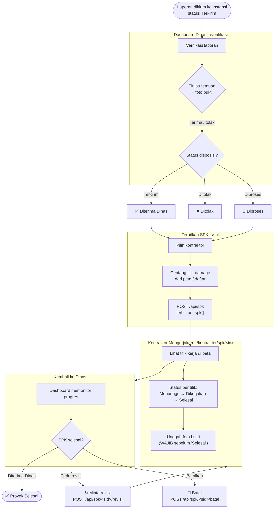

---

## 8. Alur Kerja Kontraktor

Kontraktor bekerja di ruang kerja terpisah dengan sidebar aksen **hijau**
(berbeda dari dashboard dinas).

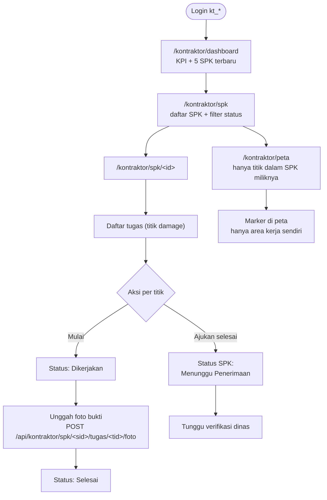

### Aturan Ketat

- Kontraktor **tidak bisa** melihat SPK kontraktor lain → **404**.
- Titik **tidak bisa** berstatus "Selesai" tanpa foto bukti.
- Transisi status **hanya satu tahap** (`SPK_TRANSISI`, `TUGAS_TRANSISI`).

---

## 9. Alur Penerimaan Hasil Kerja (BAST)

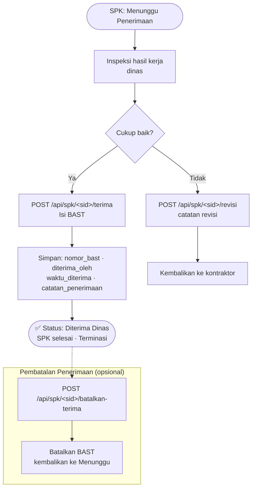

---

## 10. Diagram State Machine Status

### 10a. Status SPK

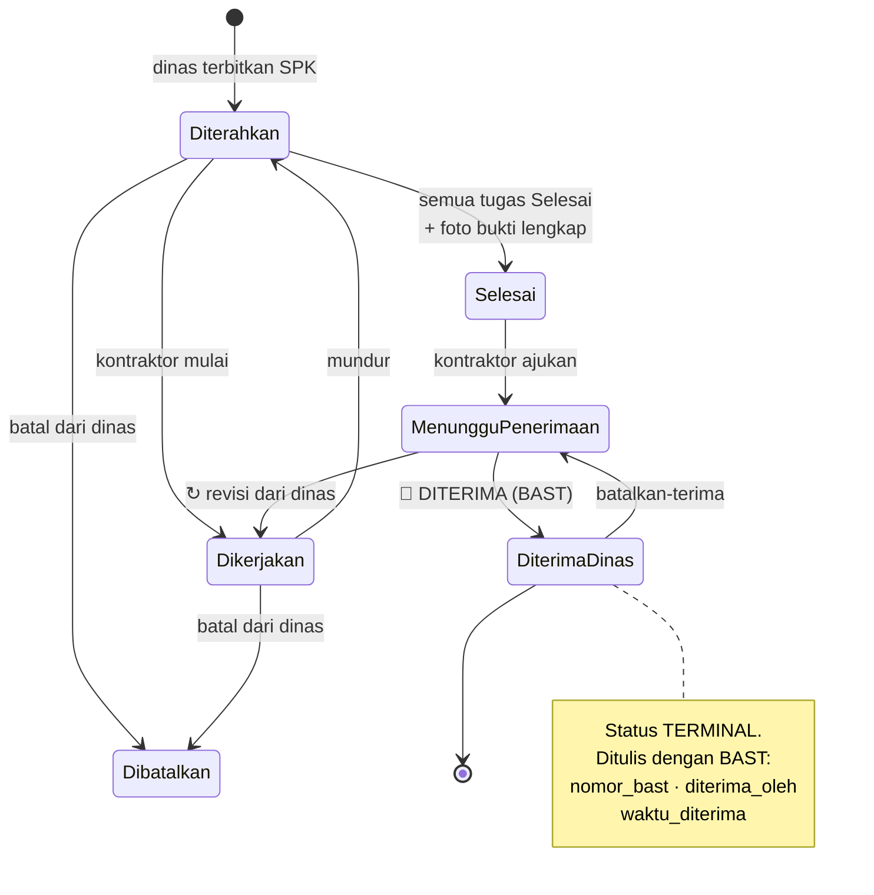

### 10b. Status Tugas (per titik)

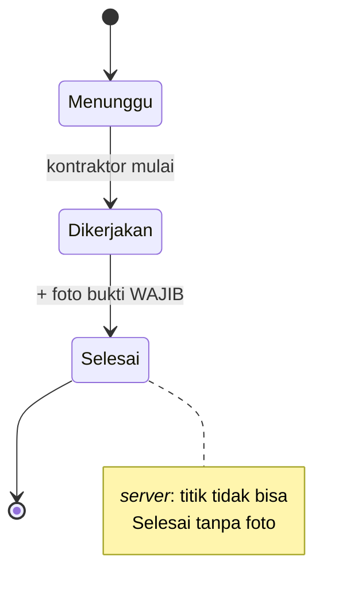

### 10c. Status Disposisi (laporan ke instansi)

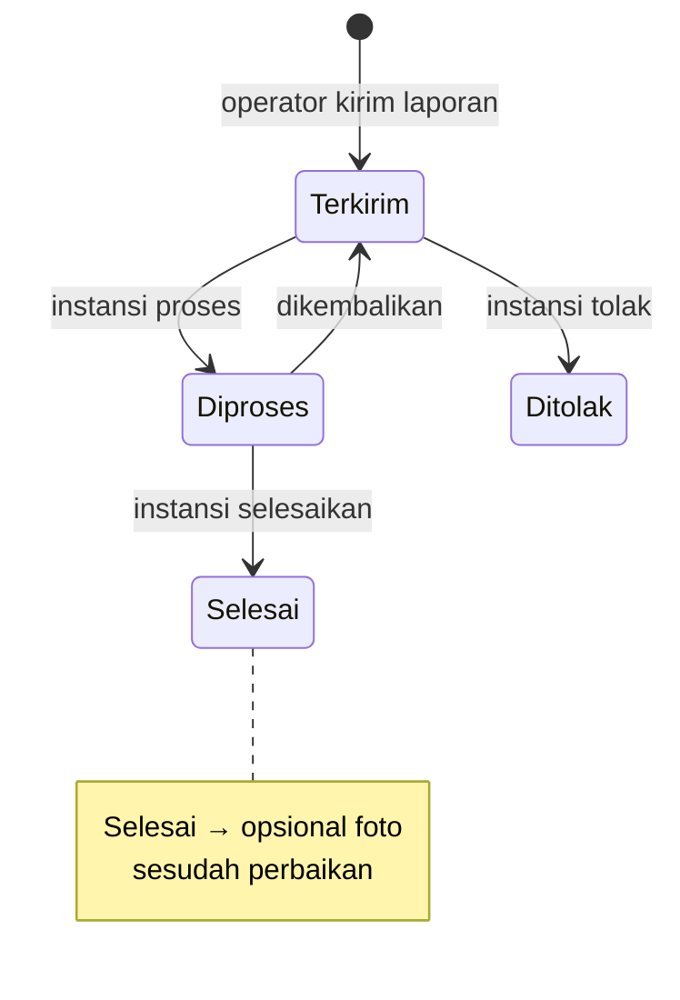

---

## 11. Diagram Pipeline Inferensi

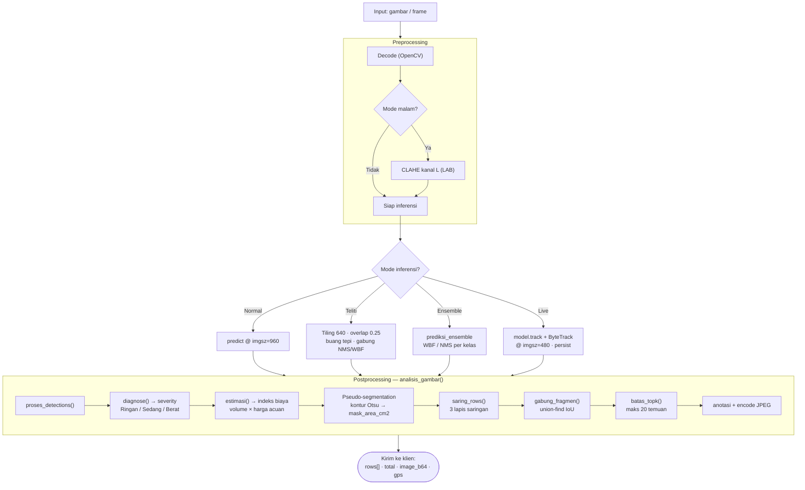

### Jalur Saringan (3 Lapis)

| Lapis | Kriteria | Sumber |
|-------|----------|--------|
| 1 | `conf < ambang_efektif` per kelas | `toleransi_kelas` di `inferensi.yaml` |
| 2 | Ukuran fisik tidak masuk akal | `batas_ukuran` (300cm / 100cm / 100m²) |
| 3 | Luas piksel < `luas_min_px` (default 900) | `saring.luas_min_px` |

---

## 12. Arsitektur 3-Thread Live Streaming

Kunci kenapa preview tetap halus meski inferensi lambat: **decoupling** tiga
pekerjaan ke thread terpisah.

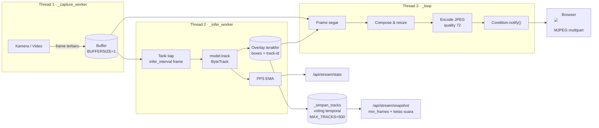

**Prinsip:** thread capture tidak pernah menunggu inferensi. Inferensi boleh
lag, tapi preview tidak boleh *stall*.

---

## 13. Peta Kode Sumber

### Entry Point

| Peran | File | Baris |
|-------|------|-------|
| Web app (WAJIB) | `web/app.py` | `app = create_app()` @ 1951 |
| Blok `__main__` | `web/app.py` | 1970–1974 |
| Preload model di background | `web/app.py` | 1953–1968 |
| Prototipe lama (deprecated) | `app/app_streamlit.py` | — |

### Route Penting

| Route | Baris | Fungsi |
|-------|-------|--------|
| `POST /api/detect` | 663 | Deteksi gambar |
| `POST /api/verifikasi` | 776 | Koreksi operator |
| `POST /api/laporan` | 797 | Generate PDF |
| `POST /api/stream/start` | 889 | Mulai live stream |
| `GET /api/stream` | 827 | MJPEG |
| `POST /api/stream/snapshot` | 956 | Snapshot live |
| `POST /api/riwayat` | 1053 | Simpan sesi |
| `GET /api/peta` | 1141 | Titik peta (publik) |
| `POST /api/disposisi` | 1282 | Kirim laporan |
| `POST /api/spk` | 1826 | Terbitkan SPK |
| `POST /api/spk/<sid>/terima` | 1869 | BAST |
| `POST /api/kontraktor/spk/<sid>/tugas/<tid>/foto` | 1778 | Foto bukti |

### Fungsi Inti

| Fungsi | File | Baris |
|--------|------|-------|
| `analisis_gambar` | `web/deteksi.py` | 1085 |
| `prediksi_teliti` | `web/deteksi.py` | 991 |
| `proses_detections` | `web/deteksi.py` | 662 |
| `gabung_fragmen` | `web/deteksi.py` | 700 |
| `get_model` (singleton) | `web/deteksi.py` | 546 |
| `diagnose` (severity) | `app/severity.py` | 53 |
| `estimasi` (biaya) | `app/biaya.py` | 53 |
| `buat_laporan` (PDF) | `app/laporan.py` | 34 |
| `simpan_sesi` | `web/database.py` | 405 |
| `rekap_temuan` | `web/database.py` | 522 |
| `terbitkan_spk` | `web/database.py` | 1302 |
| `terima_hasil_kerja` | `web/database.py` | 1708 |
| `StreamManager` | `web/streaming.py` | 42 |

---

## Lampiran — Catatan Limitation yang Jujur

Aplikasi ini **sengaja** menyatakan batasan berikut (dari README & DESIGN):

1. **Bukan segmentasi.** Deteksi *bounding box*; luas diestimasi dari kontur
   di dalam box (*pseudo-segmentation*), bukan mask model.
2. **Akurasi belum mencapai target.** YOLOv11s: mAP50 val 0,6483 (target
   ≥ 0,65 belum tercapai). Dataset latih RDD2022 (India/Jepang).
3. **Kamera mono tidak mengukur kedalaman.** Tebal = asumsi per severity.
4. **Harga = indeks relatif**, bukan RAB resmi. Semua tabel harga berlabel
   `CONTOH-...`.
5. **Mode malam hanya fotometrik** (CLAHE), tidak menambah sumber cahaya.
6. **Istilah**: selalu "indeks biaya" / "indeks prioritas", **tidak pernah**
   "biaya perbaikan" mutlak.

---

*Dokumen ini dibuat untuk keperluan dokumentasi skripsi. Struktur route dan
nama fungsi diverifikasi langsung dari kode sumber.*